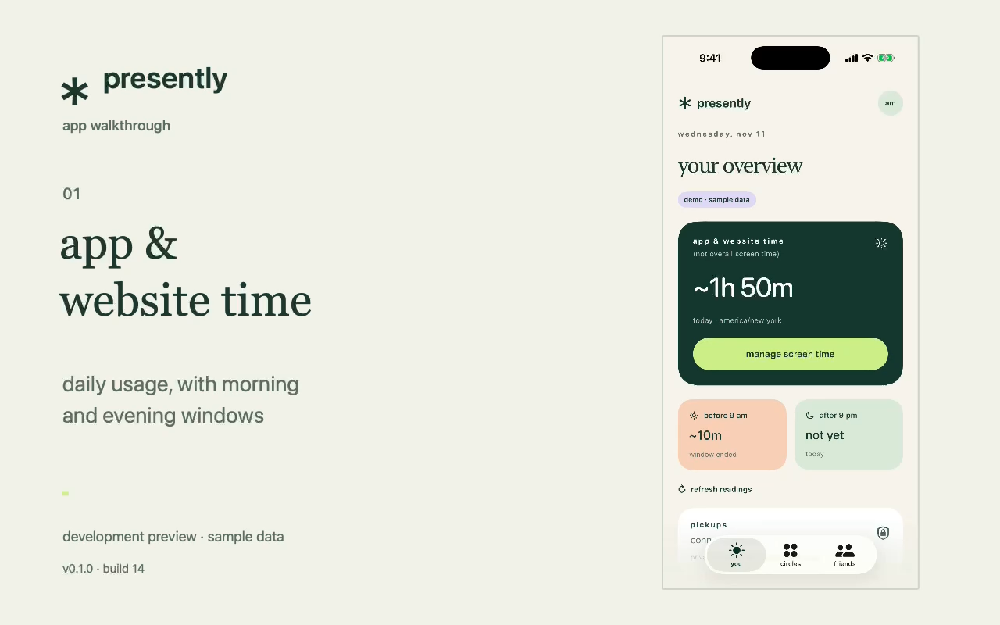

# presently demo

**[watch the demo](https://narenkarur.github.io/presently-demo/)** · **[download the mp4](https://narenkarur.github.io/presently-demo/presently-demo.mp4)**

presently is an iPhone app for tracking app and website usage, comparing with friends, and setting solo or shared challenges.

## in the video

- daily usage, morning/evening windows, and weekly history
- friends’ shared usage and signal recency
- named circles, group comparisons, and 16 custom symbols
- solo limits, duration presets, friend invitations, and custom prizes

this 76-second silent walkthrough has on-screen captions. it was recorded from **0.1.0 (14)** using the app’s labeled simulator demo. people and readings are sample data. real measurement requires an authorized physical iPhone. the demo shows the interface, not proof of live screen time collection or completed challenge settlement.

## this repository

this public repository hosts only the finished demo and its player. the application source stays in a separate private repository.

- `index.html`: responsive player with chapter buttons and a text overview
- `presently-demo.mp4`: h.264 video, optimized for web playback
- `poster.png`: preview frame
- `chapters.json`: section timestamps
- `.nojekyll`: serves these static files directly through GitHub Pages

there is no build step. GitHub Pages publishes the root of `main`. to update the demo, replace the media and chapter timestamps, then push. no account, Apple permission, or app installation is needed to watch it.
